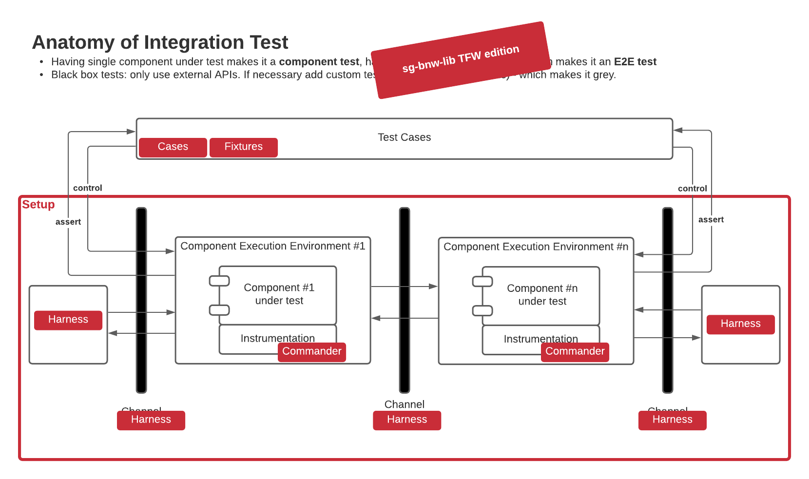

# BNW Test Framework



The test framework contains components, fixtures and some utility functions. 

## Component

A component is a piece of software that can be controlled as part of tests.
All components offer `start`, `ready` and `stop` methods.
We distinguish between commander and harness components.

### Commander

A commander is a component that controls / commands / instructs an actual (unmodified, un-instrumented) software component as it is run in the field.

### Harness

A harness is a component that supports running a test. A harness can be multiple things:
- Simplified or extended version/implementation of an actual software component (e.g. mock, stub, alternative)
- Implementation of required infrastructure for a software components (e.g. communication channel)
- Component for exercising the components under test, like injecting inputs and asserting outputs. (e.g. lwm2m testing client)

## Fixtures

Pytest fixtures for re-use. You can import them individually or configure them as plugins for them to be available in all tests.

#### Example: Use globally
In your `conftest.py` add:
```
pytest_plugins = ["bnw.tfw.fixtures.network", "bnw.tfw.fixtures.cloud", "bnw.tfw.fixtures.eventbus"]
```

#### Example: Use individually

In your test file import them:

```
from bnw.tfw.fixtures.cloud import *  # noqa
```

You can also import even more fine-grained individual fixtures, but the imported fixture itself might depend on others fixtures, so you 
have to make sure that you import all that is required (or provide the fixtures yourself)


### Cases

Provides re-usable `pytest_cases` cases for different components or other prerequisites for tests that have multiple variations.

#### Examples
Run test for all variations of the component:
```
@parametrize_with_lwm2mserver
async def test_lwm2mserver(lwm2mserver):
    ...
```

Get one particular variation
```
@parametrize_with_cloudadapter(has_tag="native")
@parametrize_with_lwm2mserver(has_tag="native")
async def test_inclusion(cloudadapter, lwm2mserver):
    ...
```

### Setups

Provides common (integration) test setups ready to be used without having to care about details.
Consists of commanders for components inside test setup and harness at the test boundary.
Setups are less configurable and customizable, if you need more control, you can use fixtures and cases to build your own setup.

#### Examples:

```
from bnw.tfw.fixtures.setups.native_gateway import NativeGatewayTestSetup

NativeGatewayTestSetup.install(__name__)

async def test_exclusion(native_gateway_test_setup: NativeGatewayTestSetup):
    ...
```

